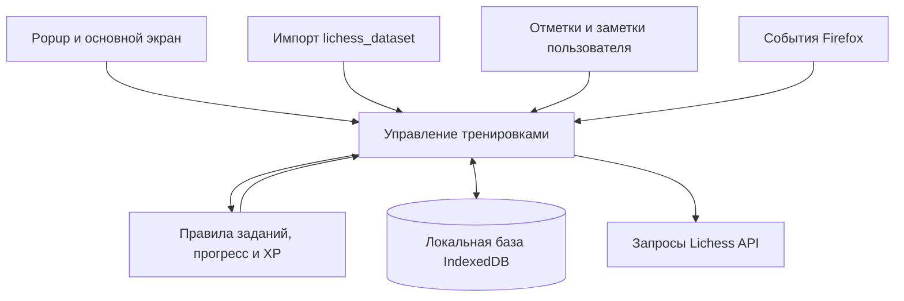

# Lichess Training: архитектура и план

6 октября 2026. Версия 0.3.0 добавляет к журналу и импорту ручное обновление партий из публичного API. Импорт собственного датасета проверен через сервис и хранилище; небольшой запрос к настоящему API проверен отдельно. Ручная установка и практика в Firefox остаются отдельной проверкой.

## Назначение

Персональное Firefox-расширение для программ шахматных тренировок на Lichess: задания на партии, задачи и разборы, история прогресса, XP и обзор регулярности. Разработка сопровождается обучением устройству addons.

Подтверждены Firefox как первая платформа, обязательность обучения и использование собственного lichess_dataset. План и архитектура представлены перед реализацией. Для первого этапа приняты вкладка расширения, краткий popup и локальный профиль; нагрузка полной программы и формат последующих занятий ещё обсуждаются.

Первый рабочий сценарий: одно задание «10 задач», собственная отметка выполнения, история последних семи дней и экспорт/восстановление. Второй этап добавляет импорт партий, таблицу результатов по контролям и график рейтинга; третий — публичный API и сегодняшние счётчики. [План этапа 1](plans/2026-10-04-first-training-loop.md), [план этапа 2](plans/2026-10-04-history-import.md) и [план этапа 3](plans/2026-10-06-live-games.md).

Рабочее предположение для первой версии: один Lichess-аккаунт и одна локальная база в Firefox. Собственный сервер предлагается добавлять, только если потребуется синхронизировать локальные заметки и награды между устройствами. Партии, сыгранные с других устройств на том же аккаунте, можно получать через API.

## Пользовательский сценарий

1. Указать аккаунт, импортировать исходную историю и выбрать программу.
2. Открыть «Сегодня» и увидеть задания и текущее выполнение.
3. Перейти на Lichess для игры или задач.
4. Получить новые завершённые партии после синхронизации.
5. Разобрать выбранную завершённую партию и сохранить собственный вывод.
6. Получить XP за выполненные задания, посмотреть обзор недели и запланированные повторения.

Пример дня: «5 bullet, 5 blitz, 10 задач, 1 разбор». Это пример конфигурации, а не предлагаемая обязательная нагрузка. Объём и тренировочные дни выбираются отдельно.

## Что будет в интерфейсе

| Часть | Содержимое |
|---|---|
| Popup | Краткий прогресс дня, XP/уровень, время последней успешной синхронизации, переход на основной экран |
| Сегодня | Задания с целью, выполнением и ссылкой на соответствующий инструмент Lichess |
| Программа | Название, тренировочные дни, нормы по контролям, задачи и разборы; простой шаблон и редактирование норм |
| Прогресс | Календарь занятий, выполнение программы по неделям, число игр, отдельные рейтинги bullet/blitz/rapid/puzzles |
| Разборы | Очередь завершённых партий, ссылка на анализ Lichess, ключевой ход, причина ошибки, собственный вывод |
| Настройки | Аккаунт, часовой пояс, импорт/экспорт, подключение задач в последующей версии |

«Сегодня», «Программа», «Прогресс», «Разборы» и настройки — разделы одной страницы расширения. Popup открывает эту страницу. Для первого выпуска предлагается хранить собственные отметки задач вручную, автоматически учитывать партии и отдельно записывать разборы. В интерфейсе различается выполнение, полученное из истории Lichess, и собственная отметка пользователя.

Три группы показателей не смешиваются: выполнение программы, шахматные результаты и изучение разработки. XP отражает тренировки; рейтинг — результаты игр; учебные достижения записываются отдельно, после практической проверки.

## Объём первой полезной версии

- Popup и основной экран Firefox-расширения.
- Один аккаунт, одна активная программа, выбранные дни занятий и настраиваемые цели.
- Импорт lichess_dataset и история партий/рейтингов.
- Автоматический счётчик подходящих завершённых партий из публичного API.
- Собственные отметки задач и разборы с заметкой, привязанной к партии.
- XP за завершение задания, уровни и недельный обзор.
- Локальное хранение, экспорт и восстановление резервной копии.

Следующая версия: OAuth для новых задач, повторение своих ошибок, напоминания и небольшой виджет на Lichess. Боковая панель, Chrome, общий доступ и синхронизация собственных заметок между устройствами — возможные расширения после проверки личного сценария.

Разборы используют инструменты Lichess. Встраивание собственной доски и движка не требуется для первого сценария: пользователь открывает завершённую партию и сохраняет вывод в расширении. Помощь с ходами текущей партии не входит в тренировочный сценарий. [Lichess fair play](https://lichess.org/page/fair-play).

## Архитектура



Основной принцип: интерфейс отправляет небольшие команды и получает готовое состояние. Все изменения тренировочной базы проходят через один модуль управления. Правила задания получают данные и даты явно; они не обращаются к браузеру или сети.

| Модуль | Ответственность | Примеры интерфейса |
|---|---|---|
| `ui` | Popup и разделы основного экрана | Показать состояние; отправить команду |
| `background` | Слушатели Firefox, передача команд | Открытие интерфейса, сообщение, позднее alarm |
| `training` | Координация операций, один владелец изменений | Получить день; сохранить разбор; импортировать; синхронизировать |
| `training-engine` | Фильтры партий, день программы, выполнение заданий, право на награду | Рассчитать результат по программе и фактам |
| `repository` | База, версии схемы, записи, транзакции, резервные копии | Сохранить пакет; записать выполнение и награду; прочитать историю |
| `lichess-api` | HTTP, NDJSON, ошибки сети, последовательные запросы | Получить ограниченную порцию партий или рейтингов |
| `dataset-import` | Проверка локального файла и преобразование записей | Импортировать исходную историю и показать отчёт |

Импорт и API используют одну функцию нормализации партий. Отдельный универсальный движок плагинов, очередь фоновых заданий или система подписок не нужны для этой схемы. Модули можно реализовать обычными функциями.

Предлагаемая структура будущего кода:

```text
extension/
  manifest.json
  background.js
  ui/                  popup, основной экран, стили
  app/                 training.js
  core/                training-engine.js
  data/                repository.js, normalize-game.js, dataset-import.js
  integration/         lichess-api.js
lessons/               учебные материалы
reference/             краткие памятки
```

Стартовый вариант — JavaScript с ES modules, HTML и CSS. Нужность TypeScript и сборщика уточняется по опыту пользователя. Разделение модулей сохраняется при любом выборе языка.

Firefox MV3 использует фоновые scripts/event pages; состояние восстанавливается из базы при повторном запуске фонового контекста. Слушатели регистрируются сразу, база открывается внутри обработчиков. [Mozilla: background](https://developer.mozilla.org/en-US/docs/Mozilla/Add-ons/WebExtensions/manifest.json/background).

Текущая база IndexedDB не требует разрешения `storage`. Доступ к сети ограничен необязательным `https://lichess.org/*`; необязательная декларация `authenticationInfo` относится к передаче имени профиля. Кнопка запрашивает оба разрешения непосредственно в пользовательском действии, перед первым await; фон проверяет их перед каждой порцией. Отказ и отзыв доступа останавливают загрузку. Для будущего OAuth проверяется `identity`. [Mozilla: host_permissions](https://developer.mozilla.org/en-US/docs/Mozilla/Add-ons/WebExtensions/manifest.json/host_permissions), [встроенное согласие Firefox](https://extensionworkshop.com/documentation/develop/firefox-builtin-data-consent/).

## Данные и хранение

Для истории предлагается IndexedDB: она поддерживает структурированные записи, индексы и транзакции. [Mozilla: IndexedDB](https://developer.mozilla.org/en-US/docs/Web/API/IndexedDB_API). В ней находятся все данные, которые совместно определяют тренировочный прогресс:

| Запись | Что хранится |
|---|---|
| Профиль | Lichess ID, настройки учёта, исходная история |
| Программа и запуск | Шаблон, версия, начало, тренировочные дни, зафиксированный часовой пояс |
| Задание дня | Стабильный ID, цель, правило выполнения и награда |
| Партия | ID, исходные времена, контроль, rated/variant/status, цвет, результат, рейтинги; данные анализа при наличии |
| Собственная отметка задач | Количество, дата, источник отметки пользователя |
| Разбор | Game ID, ключевой ход, вывод, дата завершения разбора |
| Награда | ID задания, вид награды, XP и время начисления |
| Состояние синхронизации | Успешный контрольный момент, покрытие импортированной истории, незавершённые проверки |

`browser.storage.local` подходит для небольших предпочтений интерфейса. Тренировочные данные и контрольные моменты синхронизации остаются в одной базе, чтобы связанные изменения сохранялись согласованно. [Mozilla: storage.local](https://developer.mozilla.org/en-US/docs/Mozilla/Add-ons/WebExtensions/API/storage/local).

Выполнение задания и награда записываются одной транзакцией, без сетевого запроса внутри неё. У награды уникальный ключ задания и вида награды. Суммарный XP выводится из журнала наград; повторный импорт или синхронизация не создают второе начисление.

Резервная копия содержит версию схемы и тренировочные данные. Данные авторизации будущего подключения задач в экспорт не попадают. Привязка данных к аккаунту проверяется при импорте, чтобы не смешать историю разных игроков.

## Правила учёта

- По умолчанию предлагается считать завершённые rated standard партии выбранных контролей. Casual можно включить в отдельном правиле программы.
- Ничьи учитываются; отсутствие победителя само по себе не означает, что партия ещё идёт.
- Для MVP партия относится ко дню её начала, а разбор — ко дню сохранения собственного вывода. Часовой пояс фиксируется при запуске программы; предлагаемое начальное значение — Asia/Bishkek.
- Изменение норм программы действует со следующего тренировочного дня; выполненные задания и уже начисленные награды сохраняются.
- Импорт исторического снимка формирует базовую статистику. Новый тренировочный XP начинается с запуска программы.
- За каждое выбранное задание полагается одна награда. Дополнительные партии сверх нормы видны в истории, но не порождают бесконечное начисление за то же задание.
- Серия учитывает запланированные тренировочные дни; правила отдыха задаются программой.

Экспорт содержит `createdAt` и `lastMoveAt`, но документированного точного `finishedAt` в проверенной схеме нет. Поэтому выбранное правило дня не выдаёт время последнего хода за точное время окончания. [Схема партии](https://github.com/lichess-org/api/blob/master/doc/specs/schemas/GameJson.yaml).

## Синхронизация и ограничения API

В версии 0.3.0 сеть запускает только кнопка. Открытие экрана, фокус и смена дня перечитывают локальные данные. Кнопка обрабатывает до пяти порций по 200 строк; остановка действует между порциями. Следующее нажатие продолжает сохранённый цикл. Автоматическое обновление при работающем Firefox остаётся возможным следующим этапом.

Экспорт запрашивается без rated/perfType/analysed фильтров, с sort=dateAsc, ongoing=true и finished=true. В этом пути since включителен, until исключителен и относится к createdAt. Подходящие завершённые rated standard партии выбираются локально; незавершённые и другие контроли участвуют в движении сырого курсора. [GameApiV2](https://github.com/lichess-org/lila/blob/master/modules/api/src/main/GameApiV2.scala), [Query](https://github.com/lichess-org/lila/blob/master/modules/game/src/main/Query.scala).

Начало окна фиксируется при первом сохранённом пакете: последняя известная партия минус семь дней или последние 30 дней при пустой базе. Каждый новый цикл перечитывает всё окно, чтобы найти игры, начавшиеся в нём и завершившиеся позже. Игры до этой границы не входят в заявленное покрытие. Верхняя граница фиксируется для цикла; курсор продолжает с последнего createdAt включительно. Заполненная порция без продвижения даты даёт ошибку вместо пропуска равных времён. Короткая порция завершает период; только тогда обновляется время полной успешной загрузки.

Games и sync metadata записываются одной транзакцией IndexedDB v2. Revision отклоняет устаревшую запись другого контекста; в одном фоне одновременные nextBatch используют один запрос. Повторный ID может получить более новые ходы, рейтинг и анализ, но пропущенные поля не стирают известные сведения. Метки тренировок и insert-only импорт сохраняют прежнее поведение.

Запросы идут по одному, без cookies и токена. Таймаут 30 секунд охватывает чтение тела; размер порции ограничен 8 МиБ и 200 непустыми строками. При HTTP 429 пауза не менее минуты с учётом Retry-After сохраняется в базе. Ошибка не продвигает курсор или успешное покрытие; интерфейс сохраняет последний обзор и показывает причину остановки. [Рекомендации Lichess API](https://lichess.org/page/api-tips).

История новых задач требует `puzzle:read`. Текущая серверная запись хранит дату первой попытки и последний результат по задаче. Автоматическое задание формулируется «попробовать N новых задач», а повторения учитываются отдельно. Собственная отметка и API-запись одной тренировки не складываются автоматически. [PuzzleRound](https://github.com/lichess-org/lila/blob/master/modules/puzzle/src/main/PuzzleRound.scala). OAuth и возвращение из авторизации в Firefox проверяются отдельным этапом.

Компьютерный анализ и собственный разбор — разные записи. Позднее появившийся анализ обновляет данные партии, но сам не выполняет задание разбора и не начисляет XP.

## Применение lichess_dataset

В версии 0.2.0 предварительная проверка файлов не меняет базу. Сохранение добавляет отсутствующие game ID и выбранные серии рейтингов одной транзакцией; существующие партии остаются без изменения. Схема базы версии 2 сохраняет journal версии 1 и добавляет games, ratings и historyMeta. Сервис истории возвращает готовую статистику отдельно от снимка тренировок. Backup v1 содержит только журнал отметок; история партий восстанавливается повторным импортом исходных файлов.

Импорт сохраняет ходы и собственные агрегаты анализа, но не полный анализ каждого хода и массив часов. Покрытие анализом означает наличие компьютерного анализа в источнике. Оно не подтверждает самостоятельный разбор. Последний рейтинг таблицы — известный рейтинг после последней партии. График сохраняет исходные дневные точки и дополняет их известными значениями новых дней; при отсутствии серии строится по партиям. Puzzles остаётся исходной исторической серией.

Снимок 15 марта 2026 содержит 6 429 уникальных rated standard партий; 5 917 из них — bullet. Есть один повтор исходной строки и 266 партий с компьютерным анализом.

Импортируем NDJSON как основной источник и JSON истории рейтингов. Числовые времена используются вместо противоречивых ISO-полей профиля. Проверяем метки контролей и соответствие анализа ходам. После импорта подгружаем промежуток после 15 марта небольшими порциями.

В первой версии датасет даёт исходную историю и партии для выбора разборов. В следующей — кандидатов на повторение своих ошибок. Прежние тренерские тексты используются как идеи, а не подтверждённые диагнозы. Данные качества показываются вместе с числом проанализированных партий.

Полный аудит и исходные пути: [технические основания](research/2026-10-04-lichess-training-evidence.md).

## План разработки и обучения

Порядок ниже описывает результаты этапов; сроки определяются после обсуждения бюджета времени.

| Этап | Что получаем | Чему учимся |
|---|---|---|
| 0. Дизайн | Согласованный объём первой версии, правила выполнения, экраны и данные | Архитектура расширения и связь требований с модулями |
| 1. Первый рабочий сценарий | Popup и основной экран, одно задание, сохранение собственной отметки, экспорт | Manifest, страницы, сообщения и локальная база |
| 2. История | Импорт исходного датасета, отдельная статистика по контролям и рейтингам | NDJSON/JSON, нормализация, индексы и повторный импорт |
| 3. Живые партии | Новые партии из API, автоматический счётчик, корректное повторное обновление | Permissions, HTTP, фоновые события и восстановление после ошибки |
| 4. Первая полезная версия | Программа с несколькими видами заданий, заметки разборов, XP, уровни, обзор недели | Правила, даты, транзакции и проверки поведения |
| 5. Следующая версия | OAuth задач, отдельный учёт повторений, напоминания; при необходимости виджет Lichess | Авторизация, alarms, content scripts и сообщения |
| 6. Повседневная установка | Пакет Firefox, проверка постоянной установки, перезапуска и восстановления базы | Упаковка, подпись и различия разработки/установленного addon |

У каждого этапа один цикл обучения: объяснение → небольшая реализация → самостоятельное изменение → проверка результата. Уже подготовленный первый урок используется после обсуждения дизайна; он не заменяет архитектуру продукта.

## Как будем проверять

- Датасет после импорта содержит 6 429 уникальных партий; повторный импорт не меняет число игр.
- Одна партия учитывается один раз; ничьи и выбранные контроли проходят правила, незавершённые и отменённые игры — нет.
- Игра, начавшаяся до обновления и закончившаяся после него, попадает в последующую сверку.
- Границы дня и дни отдыха соответствуют часовому поясу и программе.
- Повторное обновление, открытие двух экранов и восстановление после сбоя не начисляют XP повторно.
- Поздний компьютерный анализ не создаёт отметку самостоятельного разбора.
- Резервная копия восстанавливает программу, заметки и награды.
- В Firefox отдельно проверяются временная загрузка и поведение установленной сборки после перезапуска. [Mozilla: временная установка](https://extensionworkshop.com/documentation/develop/temporary-installation-in-firefox/).

## Решения для следующего обсуждения

1. Где удобнее видеть программу: во вкладке расширения с кратким popup или преимущественно внутри Lichess? Предложение этого документа — вкладка и popup.
2. Нужны ли собственные заметки и награды на нескольких устройствах? Для первого выпуска предлагается локальный профиль.
3. Какой реальный бюджет времени на шахматы и на разработку? Это определит нормы программы и размер учебных этапов.
4. Приемлем ли первый выпуск с ручными отметками задач и автоматическими партиями, с OAuth задач следующим этапом?

Эти вопросы уточняются по мере работы; они не блокируют первый локальный сценарий. Его интерфейсы и проверки зафиксированы в плане этапа 1.
