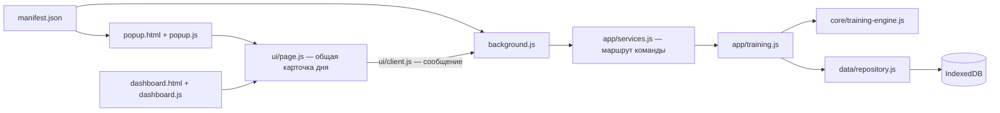

# Первое изменение в рабочем Firefox addon

Цель занятия — увидеть, как исходный файл становится частью интерфейса браузера. Сначала установи расширение из `extension/manifest.json` по инструкции в README.

## Карта файлов

`manifest.json` сообщает Firefox, какую кнопку и какую фоновую страницу создать. `popup.html` открывается при нажатии на кнопку расширения; popup закрывается при переходе к другой вкладке. Основной экран живёт во вкладке и поэтому удобнее для истории и резервных копий.

Общий обработчик карточки дня находится в `ui/page.js`; его подключают и popup, и dashboard. Страницы отправляют команды через `ui/client.js` и `browser.runtime.sendMessage`. `background.js` регистрирует обработчик из `background-transport.js`; `app/services.js` направляет команду сервису тренировок. Сервис выбирает день в часовом поясе программы и сохраняет изменения в IndexedDB. Поэтому закрытие popup не стирает отметку. Фоновая страница может выгружаться из памяти: источником состояния остаётся база.

Отметки задач хранятся одной записью state в store journal. В версии 0.4.0 соседний ключ practice содержит нормы, собственные заметки и награды; связанные изменения сохраняются одной транзакцией. В версии 0.2.0 партии получили отдельные записи и индексы; большой датасет не входит в этот журнал или пакет расширения.

## Упражнение 1: найди границу интерфейса

1. Открой popup и запомни заголовок.
2. Найди его видимый текст в `extension/ui/popup.html` и измени на своё название, например «Моя шахматная практика». Не меняй `id` элементов или пути файлов.
3. Сохрани файл. В `about:debugging#/runtime/this-firefox` нажми **Reload** у расширения.
4. Снова открой popup и проверь новый заголовок.
5. Отметь выполнение на основном экране, закрой его и открой через popup. Проверь, что отметка сохранилась.

Предскажи до изменения: поменяется ли от переименования popup заголовок основного экрана? Затем проверь. Это помогает отделить две HTML-страницы от общего сервиса данных.

## Упражнение 2: проследи команду

Найди обработчик кнопки выполнения в `extension/ui/page.js`. Проследи путь от `training.setCompletion` через `extension/ui/client.js`, `extension/background-transport.js` (подключён из `background.js`), `extension/app/services.js` и `extension/app/training.js` через `extension/app/practice.js` к `extension/data/repository.js`. `dashboard.js` дополняет общую карточку историей и резервными копиями.

Ответь своими словами:

- Почему в команде передаётся дата, которую показывал экран?
- В какой момент интерфейс вправе показать «выполнено»?
- Что останется после закрытия popup, а что исчезнет?

Дата защищает от клика в старом экране после полуночи. Успех показывается после завершения транзакции. HTML и JavaScript popup создаются заново при его открытии; журнал остаётся в базе.

## Практика резервной копии

Экспортируй JSON, открой его в редакторе и найди дату и `completedAt`. Затем сними сегодняшнюю отметку и восстанови сохранённую копию через предварительный просмотр. Восстановление заменяет текущий журнал, поэтому для эксперимента сначала сохрани актуальную копию.

Для настройки уже начатой программы используй форму норм на основном экране: изменения действуют с завтра. Начальные значения в коде применяются только при создании новой программы.

Продолжение — [урок 03: импорт настоящего lichess_dataset](../../lessons/0003-history-import.html). Освоение будет записано в NOTES только после практической проверки.

## Источники

- [Mozilla: anatomy of an extension](https://developer.mozilla.org/en-US/docs/Mozilla/Add-ons/WebExtensions/Anatomy_of_a_WebExtension)
- [Mozilla: background scripts and event pages](https://developer.mozilla.org/en-US/docs/Mozilla/Add-ons/WebExtensions/manifest.json/background)
- [Mozilla: временная установка](https://extensionworkshop.com/documentation/develop/temporary-installation-in-firefox/)

Программа с несколькими заданиями, собственным разбором и XP объясняется в [уроке 05](../../lessons/0005-daily-program.html).
